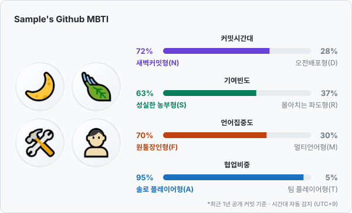
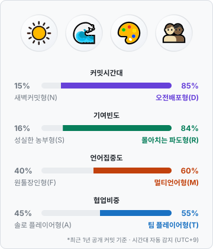

# 깃허브 MBTI

> 내 깃허브의 MBTI는 무엇일까? (\*커밋 내역을 기반으로 측정됩니다.)

GitHub 공개 활동을 분석해 4글자 개발자 유형을 카드로 보여 줍니다. 프로필 README에 이미지로 붙여 넣을 수 있어요.

<p align="center">
  
</p>

<p align="center">
  <a href="https://github-mbti-whoami.vercel.app"><b>👉 웹에서 바로 내 유형 확인하기</b></a>
</p>

## Demo

### 웹에서 바로 해 보기

1. [github-mbti-whoami.vercel.app](https://github-mbti-whoami.vercel.app)에 들어갑니다.
2. **미리보기**에 GitHub 아이디를 입력하고 버튼을 누르면 카드가 바로 그려져요.
3. 마음에 들면 카드를 저장하거나 공유하고([Share your result](#share-your-result)), README에 붙여 넣으세요.

로그인이나 설치는 필요 없어요. 공개 활동만 읽기 때문에 아이디만 있으면 돼요.

### 프로필 README에 붙이기

1. 아래 코드를 복사합니다.

   ```html
   <a href="https://github-mbti-whoami.vercel.app"
     ></a>
   ```

2. `{githubID}`를 내 GitHub 아이디로 바꿉니다.
3. 필요하면 `tz` 값을 바꿉니다 (아래 표 참고).
4. 내 프로필 README(`<아이디>/<아이디>` 저장소의 `README.md`)에 붙여 넣으면 카드가 표시됩니다.

| 파라미터 | 값                                  | 동작                                                                                                                                     |
| -------- | ----------------------------------- | ---------------------------------------------------------------------------------------------------------------------------------------- |
| `tz`     | `auto` (기본)                       | 커밋 시각에 기록된 시간대(오프셋)로 자동 감지해요. 생략해도 같아요.                                                                      |
| `tz`     | `Asia/Seoul`, `America/New_York` 등 | 모든 커밋을 그 시간대로 바꿔서 판정해요. [IANA 시간대 이름](https://en.wikipedia.org/wiki/List_of_tz_database_time_zones)을 넣어 주세요. |
| `layout` | 생략 (기본)                         | 아이콘이 왼쪽, 막대가 오른쪽인 가로 카드(700px)                                                                                          |
| `layout` | `compact`                           | 아이콘이 위, 막대가 아래인 세로 카드(360px). 좁은 공간에 넣을 때 써 보세요.                                                              |

- 서버·CI·컨테이너에서 커밋하면 시간대가 `UTC`로 잡힐 수 있어요. 카드 하단에 감지된 시간대가 표시되니, 실제와 다르면 `tz`를 직접 지정하세요.
- 카드는 1시간 동안 캐싱되므로 새 커밋이 바로 반영되지는 않아요.

## How it works

GitHub GraphQL API로 **최근 1년의 공개 활동**을 읽어 4가지 축을 판정하고, 판정된 글자 4개를 이어 유형을 만듭니다.

```
GitHub 아이디 → GraphQL 조회 2번 → 4축 판정 → SVG 카드 렌더 → 1시간 캐싱
```

| 축   | 유형                                        | 판정 기준                                                                         | 읽는 데이터                                 |
| ---- | ------------------------------------------- | --------------------------------------------------------------------------------- | ------------------------------------------- |
| 시간 | **N** 새벽커밋형 / **D** 오전배포형         | 20~05시 커밋 비율이 **40% 이상**이면 N                                            | 커밋 시각 (작성자의 시간대 그대로)          |
| 리듬 | **S** 성실한 농부형 / **R** 몰아치는 파도형 | 1년 중 기여한 날 비율이 **35% 이상**이면 S                                        | 기여 달력 (잔디)                            |
| 범위 | **F** 원툴장인형 / **M** 멀티언어형         | 가장 많이 쓴 언어 비율이 **60% 이상**이면 F (커밋한 날 수로 가중)                 | 커밋한 저장소의 주 언어                     |
| 협업 | **A** 솔로 플레이어형 / **T** 팀 플레이어형 | 팀 저장소 커밋 비율 **25% 이상**, 또는 팀 저장소 PR + 리뷰 **30건 이상**이면 T | 저장소 소유자, PR·리뷰 기여 (내 저장소 PR 제외) |

- **팀 저장소**는 내 소유가 아닌 저장소(조직·다른 사람의 저장소)를 말해요.
- 커밋 시각은 커밋을 가장 많이 한 저장소 5곳의 기본 브랜치 커밋(저장소당 최근 100개)을 기준으로 합니다.
- 비공개 저장소는 개수만 알 수 있어 판정에서 빠집니다.
- 판정 기준과 유형 이름은 아직 초안이에요. 의견은 [이슈](https://github.com/minji-kim0524/github-mbti/issues)로 남겨 주세요.

### 카드 읽는 법

- 막대 위 가운데 글자는 **판정 기준**(커밋시간대, 기여빈도, 언어집중도, 협업비중)이에요.
- 막대 양 끝에는 두 성향의 **비율**과 **이름**이 있고, 판정된 쪽이 축 색깔로 강조돼요.
- 막대는 판정된 쪽 끝에서부터 그 비율만큼 채워져요.
- 데이터가 부족한 축은 기준 옆에 `데이터 부족`이 붙고 비율 대신 `-`가 표시돼요.

## Sample results

<table>
  <tr>
    <th>가로 카드 (기본)</th>
    <th>세로 카드 (<code>layout=compact</code>)</th>
  </tr>
  <tr>
    <td></td>
    <td></td>
  </tr>
  <tr>
    <td><b>NSFA</b> · 새벽의 꾸준한 한 우물 솔로 장인</td>
    <td><b>DRMT</b> · 햇살 아래 몰아치는 잡식 팀 플레이어</td>
  </tr>
</table>

> 예시 카드는 샘플 데이터로 그린 것이에요.

유형은 4축 × 2가지 = **16가지**예요. 별명은 글자마다 붙는 수식어를 이어 붙여 만들어요 (예: N + S + F + A → "새벽의 꾸준한 한 우물 솔로 장인").

| 아이콘                                  | 글자  | 유형            | 별명 수식어 | 이런 개발자예요                                |
| --------------------------------------- | ----- | --------------- | ----------- | ---------------------------------------------- |
|    | **N** | 새벽커밋형      | 새벽의      | 해가 진 뒤에 집중력이 살아나요                 |
|    | **D** | 오전배포형      | 햇살 아래   | 낮 시간에 주로 커밋해요                        |
|    | **S** | 성실한 농부형   | 꾸준한      | 잔디를 고르게, 자주 심어요                     |
|    | **R** | 몰아치는 파도형 | 몰아치는    | 쉬다가도 한 번 몰입하면 몰아서 커밋해요        |
|    | **F** | 원툴장인형      | 한 우물     | 한 언어를 깊게 파요                            |
|    | **M** | 멀티언어형      | 잡식        | 여러 언어를 오가며 작업해요                    |
|    | **A** | 솔로 플레이어형 | 솔로 장인   | 주로 내 저장소에서 혼자 만들어요               |
|    | **T** | 팀 플레이어형   | 팀 플레이어 | 팀 저장소에 커밋하고 PR·리뷰로 함께 만들어요   |

## Share your result

[웹 페이지](https://github-mbti-whoami.vercel.app)에서 미리보기를 하면 카드 아래에 공유 버튼이 나타나요.

| 버튼        | 동작                                                                                                  |
| ----------- | ----------------------------------------------------------------------------------------------------- |
| 이미지 저장 | 화면에 보이는 카드(가로/세로)를 2배 해상도 PNG로 내려받아요.                                          |
| 링크 복사   | 결과 페이지 주소를 복사해요. 이 주소를 열면 같은 아이디·시간대의 결과가 바로 보여요.                  |
| 공유하기    | 휴대폰 등 지원하는 브라우저에서 시스템 공유 창을 열어요. 이미지를 받을 수 있는 앱에는 카드 PNG도 함께 보내요. |
| X에 공유    | 유형과 별명, 결과 링크가 채워진 X 글쓰기 창을 열어요.                                                 |

결과 링크는 `https://github-mbti-whoami.vercel.app/?user={githubID}&tz=auto` 형식이에요.

## Tech stack

| 영역       | 사용 기술                                                                 |
| ---------- | ------------------------------------------------------------------------- |
| 프론트엔드 | React 19, TypeScript, Vite, Pretendard                                    |
| 백엔드     | Hono (로컬은 `@hono/node-server`, 배포는 Vercel Function)                 |
| GitHub API | GraphQL API v4 (`@octokit/graphql`)                                       |
| 타입 공유  | Hono RPC (`hono/client`) — 서버 응답 타입을 웹에서 그대로 사용            |
| 배포       | Vercel (Vite 정적 빌드 + `api/index.ts` Function)                         |

### 구현 방식

- **서버에서 SVG를 직접 그려요.** GitHub 프로필 README는 JavaScript를 실행하지 않아서, [github-readme-stats](https://github.com/anuraghazra/github-readme-stats)처럼 서버가 이미지 주소 요청마다 SVG를 만들어 돌려줘요. DB와 로그인이 없는 **읽기 전용 · 무상태** 구조예요.
- **API 사용량을 아껴요.** 한 사람을 분석할 때 GraphQL 쿼리 2번(약 7포인트)만 쓰고, 결과는 서버 메모리와 CDN에 1시간 캐싱해요. GitHub API 한도는 토큰당 시간당 5,000포인트예요.
- **README 이미지가 깨지지 않게 해요.** GitHub 이미지 프록시(camo)는 200이 아닌 응답을 깨진 이미지로 보여 주기 때문에, 오류도 `200` + 오류 카드로 응답해요.
- **외부 입력은 안전하게 다뤄요.** 아이디·언어명 같은 값은 SVG에 넣기 전에 XML 이스케이프하고, GraphQL에는 문자열로 끼워 넣지 않고 변수로만 전달해요.
- **판정 로직은 순수 함수예요.** 기준값과 유형 이름은 `src/server/analyze.ts` 한곳에 모여 있어 GitHub API 없이도 확인하고 바꿀 수 있어요.
- **공유 이미지는 브라우저에서 만들어요.** 같은 출처의 SVG 카드를 canvas에 그려 PNG로 바꾸고, Web Share API로 공유해요.

### 폴더 구조

```
api/index.ts        Vercel Function 진입점
src/server/
  app.ts            Hono 라우트, 메모리 캐시
  github.ts         GraphQL 쿼리 2개 (기여 내역 / 상위 저장소 커밋 시각)
  analyze.ts        4축 판정 (기준값·유형 이름 모음)
  card.ts           SVG 카드 렌더
src/web/            랜딩 페이지 (README 스니펫 복사, 미리보기, 공유)
public/             유형 글자 아이콘
```

### API

| 엔드포인트                          | 응답                                               |
| ----------------------------------- | -------------------------------------------------- |
| `GET /api/card/:user?tz=&layout=`   | MBTI 카드 SVG (오류여도 200 + 오류 카드)           |
| `GET /api/mbti/:user?tz=`           | 판정 결과 JSON (유형, 별명, 축별 비율과 근거)      |

## Star & contribute

이 프로젝트가 마음에 들었다면 오른쪽 위의 **⭐ Star**를 눌러 주세요. 다른 개발자들이 프로젝트를 발견하는 데 큰 힘이 돼요.

개선에 참여하는 방법도 환영해요.

- **판정이 내 실제 모습과 다르다면** 아이디와 함께 [이슈](https://github.com/minji-kim0524/github-mbti/issues)를 남겨 주세요. 기준값을 다듬는 데 가장 큰 도움이 돼요.
- **유형 이름이나 별명 아이디어**도 이슈로 제안해 주세요.
- **버그 수정이나 기능 추가**는 저장소를 Fork 한 뒤 Pull Request를 보내 주세요. 큰 변경은 먼저 이슈로 이야기해 주시면 좋아요.

### 로컬 실행

요구사항: Node.js 22+, pnpm 10+

```bash
pnpm install
```

```bash
pnpm dev
```

- 웹: http://localhost:5173 (`/api` 요청은 API 서버로 프록시)
- API: http://localhost:8787
- 카드 예시: http://localhost:5173/api/card/torvalds?tz=auto

`pnpm typecheck`로 타입 검사, `pnpm build`로 배포용 빌드를 확인할 수 있어요.

### 환경변수

`.env*` 파일은 커밋하지 않습니다(`.gitignore`에 포함). 로컬에서는 프로젝트 루트에 `.env`를 직접 만들어 사용하세요.

| 이름           | 필수   | 설명                                                                                                                                                                         |
| -------------- | ------ | ---------------------------------------------------------------------------------------------------------------------------------------------------------------------------- |
| `GITHUB_TOKEN` | 예     | GitHub GraphQL API 호출용 토큰. [Fine-grained token](https://github.com/settings/personal-access-tokens/new)을 **권한 없이(Public repositories 읽기 전용)** 발급하면 됩니다. |
| `PORT`         | 아니오 | API 서버 포트 (기본값 `8787`)                                                                                                                                                |

### 직접 배포하기 (Vercel)

`vite build` 결과(`dist`)는 정적 파일로, `api/index.ts`는 Vercel Function으로 배포됩니다. 설정은 `vercel.json`에 있습니다.

1. [Vercel](https://vercel.com/new)에서 Fork 한 저장소를 Import 합니다 (빌드 설정은 `vercel.json`이 지정).
2. Project Settings → Environment Variables 에 `GITHUB_TOKEN`을 추가합니다.
3. 배포가 끝나면 README의 카드 주소를 실제 도메인으로 바꿉니다.

이후 `main`에 push 하면 자동으로 다시 배포됩니다.
